# PixelCodec

A showcase of lossless data transformation with computer vision. A file is
turned into a stream of images and rebuilt, bit for bit, from what a camera or
screen capture sees. A SHA-256 check proves the result is identical to the
original. Everything runs in the browser.

This is a demonstration of encoding, error correction and image analysis. It
is not a network service or a file-transfer product.

Live demo: https://pixytech.github.io/PixelCodec/

Part of the Pixytech app family, listed at https://portal.pixytech.com

## Features

- Encode a file into a grid of black and white (or grey) cells, shown as an
  animated stream of frames.
- Decode from a screen capture or a camera feed, or from a saved image.
- Reed-Solomon error correction repairs damaged cells.
- Fountain coding means any sufficient set of frames rebuilds the file, so a
  missed frame costs nothing.
- Optional AES-GCM encryption with a passphrase.
- A direct lossless PNG representation (3 bytes per RGB pixel).
- Integrity check: the SHA-256 of the original file is compared with the
  rebuilt file.
- Adjustable cell size, bits per cell, parity level and frame rate.

## Architecture

### Overview

```mermaid
flowchart LR
  F[File] --> P["Package<br/>name, size, SHA-256, optional AES-GCM"]
  P --> FC["Fountain code<br/>frames over GF(2)"]
  FC --> RS["Reed-Solomon blocks<br/>interleaved"]
  RS --> G["Grid renderer<br/>finders, alignment, data cells"]
  G -->|screen or camera| CAP[Capture]
  CAP --> D["Decoder worker<br/>find finders, sample cells"]
  D --> RSD[Reed-Solomon decode]
  RSD --> FD[Fountain decode]
  FD --> V["Unpack and verify SHA-256"]
  V --> OUT[Rebuilt file]
```



### Components

- **Packaging** (`src/transfer/fileCodec.ts`): wraps the file into a stream
  with a magic marker, flags, name, size, the SHA-256 of the original and the
  body. Optionally encrypts the body with AES-256-GCM using a key derived from
  the passphrase (PBKDF2-SHA256, 150,000 iterations). Also provides the direct
  lossless PNG form.
- **Fountain code** (`src/transfer/fountain.ts`): splits the stream into equal
  chunks. The first frames carry chunks as they are. Later frames carry the XOR
  of a pseudo-random subset of chunks chosen from the frame index. The decoder
  needs any K independent frames, usually K plus one or two.
- **Reed-Solomon** (`src/transfer/rs.ts`): error correction over GF(2^8), the
  same family used by QR codes. With `nsym` parity bytes a block can repair up
  to half that many corrupted bytes.
- **Grid codec** (`src/transfer/codec.ts`): draws and reads the cell grid.
  Four finder patterns in the corners locate the grid. A small format header
  next to the top-left finder records grid size, bits per cell and parity
  level, protected by its own Reed-Solomon code, so the decoder adapts to the
  encoder settings. A lattice of alignment patterns lets the decoder correct
  curved screens and lens distortion patch by patch. Data is whitened, Reed-
  Solomon protected and byte-interleaved across blocks.
- **Decoder worker** (`src/transfer/decoder.worker.ts`): finder detection and
  decoding for each captured frame, off the main thread so the live preview
  stays smooth (about 50 to 150 ms per frame).
- **TransferView** (`src/views/TransferView.tsx`): the interface for encoding,
  capturing and decoding, with progress and verification.
- **RobotsScene** (`src/transfer/RobotsScene.tsx`): a decorative illustration
  of an encoder and a decoder. No real data flows through it.

### Design decisions

- Finder and alignment patterns follow the QR code idea so the decoder can
  find and straighten the grid without any manual setup.
- A fountain code removes the need to catch a specific frame, which suits an
  unreliable camera.
- Error correction is applied per block and interleaved, so a burst of damage
  is spread across many blocks and stays repairable.
- The SHA-256 covers the original file, so a match proves the round trip was
  exact.
- Decoding is in a worker because it is the slowest step in the loop.

### Privacy

Everything runs locally in the browser. Files, frames and passphrases are never
uploaded.

### Limits

- Capture quality matters. Motion blur, glare and very small cells reduce what
  the decoder can read.
- Larger files need more frames and take longer.
- Lossy re-encoding of saved images (for example JPEG) alters pixel values and
  can break decoding.
- Screen capture and camera access need permission and a secure context.

## Develop

```
npm install
npm run dev
npm run build
```

## Deploy

Pushing to `main` runs `.github/workflows/deploy.yml`, which builds the app and
publishes it to GitHub Pages. In the repository settings, set Pages source to
GitHub Actions. The Vite `base` in `vite.config.ts` must match the repository
name.

`portal.json` lets the Pixytech portal list this app.

## Licence

MIT. See LICENSE.
